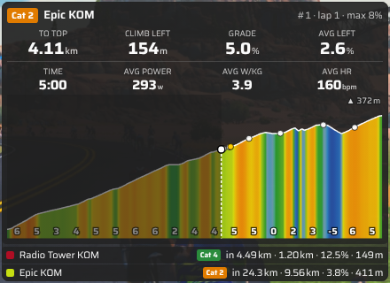
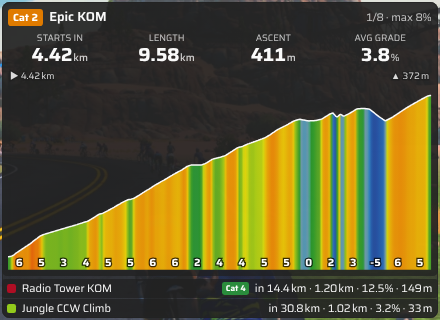
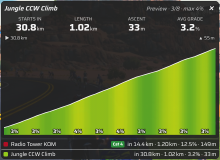
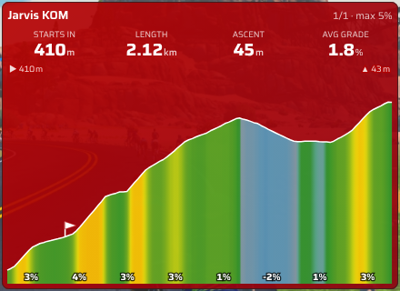
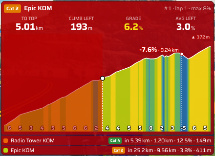
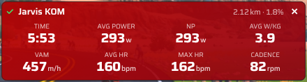

# Hill Radar for Sauce for Zwift

A [Sauce for Zwift](https://www.sauce.llc/products/sauce4zwift/) mod that finds the climbs on the route you are riding and shows the current or next climb, the same idea as a bike computer's climb feature:

- A profile of the climb colored by gradient, with your position on it
- **To top**: distance left to the top of the climb
- **Climb left**: elevation still to climb, including any dips you will have to climb back out of
- Current grade and the average grade of what is left
- Before a climb: distance to the start, length, ascent and average grade
- A list of the next climbs on the route
- Official Zwift KOMs and well-known unofficial climbs are named; climbs are numbered across laps (e.g. **4/6 · lap 2** in an event, **#5 · lap 3** on a free ride)
- A **Route climbs** list (title bar button) of every climb on the route; click any climb there or in the upcoming list to preview it
- Hover the profile to see the gradient at any point
- Optional **live climb stats** while climbing, and a **climb summary** at the top (time, power, NP, W/kg, VAM, heart rate and more; you choose which)
- Optional dots for **other riders** on the climb, and flags where the official segment starts or finishes
- **Climb Portal** climbs, named and scaled to your difficulty setting

## Screenshots

| Halfway up the Epic KOM, with live climb stats and other riders | Next climb at the start of The Uber Pretzel | Preview of a later climb |
| --- | --- | --- |
|  |  |  |

| Jarvis KOM: the timed segment starts at the flag | Barberfish colors, colored grade and the gradient under the mouse | Climb summary at the top |
| --- | --- | --- |
|  |  |  |

Shown with Sauce's Dark theme. Climbing the Epic KOM: distance to the top, climbing left (including the dip near the summit), current grade and the average of what is left, the climb so far in the live stats row, other riders on the climb (a marked rider in yellow) and the part already climbed dimmed. At the start of a route: the next climb and the ones after it. Clicking a climb in the list previews it; the ✕ goes back to live. Jarvis KOM's climbing starts about 300 m before the timed segment, so a flag marks where the segment starts. Hovering the profile shows the gradient at that point (here -7.6% in the dip near the top). At the top, the summary shows the stats you picked for the climb.

## Climb detection

A climb has to be at least 500 m long with an average grade of at least 3%. Each climb gets a score of length (m) x average grade (%), which sets its category:

| Category | Score |
| --- | --- |
| HC | 80,000+ |
| Cat 1 | 64,000+ |
| Cat 2 | 32,000+ |
| Cat 3 | 16,000+ |
| Cat 4 | 8,000+ |
| Uncategorized | below 8,000 |

The **Climb detection** setting picks the smallest climbs shown:

- **All climbs**: score 1,500 or more
- **Medium and large climbs**: score 3,500 or more
- **Only large climbs**: score 8,000 or more

**Include gentle climbs** (off by default) lowers the minimum average grade for detected climbs from 3% to 1.5%, so long gentle drags show too (e.g. the 1.9% rise out of the desert before Titans Grove on Sand and Sequoias). It adds about 250 small climbs across all routes, so it is best combined with Medium or Only large if you want fewer.

Climbs continue through dips and short descents, so a climb with a dip in the middle shows as one climb. Flat or gentle run-ups are trimmed off the ends, and each climb starts at its real bottom and ends at its real top.

Detection works on routes and events (including multi-lap and distance-based events). When riding without a route, it uses the current road, with the road's official segments for names. The same happens on a new route that Sauce doesn't have yet (Zwift sometimes releases routes before Sauce's data is updated): the climbs on the road you're on are shown, marked "this road only", until Sauce has the route.

### Climb Portal

The portal climb is shown as one climb with its name (e.g. Ski Lift Climb, Cauberg). The gradients and elevation follow your Climb Portal difficulty setting, the same way Zwift scales them, so at 50% difficulty an 8% climb shows as 4%. Like Zwift, the climb ends at the finish gate, so the flat run-out past it isn't counted. Climb names and finish gates come from Sauce (2.3 or newer).

### Climb names and official segments

When the route has an official Zwift climb segment (a KOM), that climb uses the segment's name and covers at least the segment's official start and end (detected climbing just before or after it is kept). The segment still has to average at least 3% and meet the detection size, so sprints, laps, whole-course segments and very gentle segments are not shown as climbs; segments Zwift names as a KOM count at any uphill grade, such as Itza KOM at 1.98%, as long as they meet the detection size. Official segments don't need the 500 m minimum length, so short KOMs such as Innsbruck's Leg Snapper (422 m at 6.9%) are included.

Climbs without an official segment are found from the elevation profile. When one of those matches a well-known unofficial climb (for example San Luca on the Bologna Time Trial, or the climbs named in Brian Mudge's S4Z mods), it gets that name. The same climb is also recognised on other routes, including new ones, by its start and end elevation, length and shape, so it keeps its name wherever it's ridden (if two names fit, it stays unnamed). Otherwise it is shown as "Climb 1", "Climb 2" and so on.

## On the profile

- **Gradient on hover:** hover the mouse over the climb profile to see the gradient at that point and how far into the climb it is.
- **Segment start/finish flags:** when a climb starts before or ends after its official segment (for example Jarvis KOM, whose climbing starts about 300 m before the timed segment), flags mark the segment's start (pennant) and finish (checkered). On by default; **Show segment start/finish** turns them off.
- **Other riders:** with **Show other riders** on, riders on the climb appear as dots (marked and followed riders in yellow; hover a dot for the name and gap). They're placed from each rider's own road position, so riders further up the road show too.

## Climb stats

- **Climb summary** (on by default): at the top of a climb, your stats for the climb show for a few seconds, marked "partial" if you joined partway up.
- **Live climb stats** (off by default): while climbing, a second row under the climb numbers shows the climb so far.

You choose the stats: eight slots for the summary and four for the live row, each any of time, average power, NP (Normalized Power, after 30 s on the climb), max power, average W/kg, VAM, average and max heart rate, average speed, cadence, energy (kJ), distance and climbed, or off for summary slots.

## Settings

- Climb detection: All / Medium and large / Only large
- Include gentle climbs (1.5%+ instead of 3%)
- Show next climb within (km or mi; 0 = always)
- Climb summary at the top: on/off, how long it shows (5–30 seconds) and its eight stats
- Live climb stats while climbing: on/off and its four stats
- Show other riders on the climb profile
- Show segment start/finish flags
- Hide when no climb
- Upcoming climbs list (0 to 5)
- Units: Auto (follows Sauce), Metric or Imperial
- Gradient color scheme: Classic, Sauce, Veloviewer (ish), CVD-BuRd, CVD-PRGn, CVD-Sunset, Barberfish, with a preview of the selected scheme
- Color the grade number with the gradient colors
- Gradient coloring: Smooth (high resolution, colored point by point) or Sections
- Gradient color opacity, section length, grade labels, dim the completed part
- Font scaling, theme override, solid background, data background opacity
- Show position info: shows where Hill Radar thinks you are and the data it used (handy when reporting a problem)

The window can be resized; everything scales with it.

## Install

**From the Sauce mod store** (recommended): Hill Radar is listed in the [Sauce mod store](https://mods.sauce.llc). Open Sauce's mod settings, find **Hill Radar** and install it; updates arrive the same way.

**Manually:**

1. Download the latest release from the [Releases page](https://github.com/Aryeh95/s4z-hill-radar/releases) (or a tag's **Source code (zip)** under [Tags](https://github.com/Aryeh95/s4z-hill-radar/tags)) and unzip it.
2. Put the folder in your Sauce mods folder (usually `Documents\SauceMods`). If you had an earlier copy, replace it.
3. Restart Sauce, enable **Hill Radar** in Sauce's mod settings, and add the **Hill Radar** window.

## Development

To release: bump `version` in `manifest.json` and `package.json`, add a `## <version>` section to `CHANGELOG.md`, and push to `main`. The Release workflow then tags `v<version>`, builds the zip and publishes a GitHub release with it.

`npm run zip` builds the release zip (`dist/hill-radar-<version>.zip`, a single `hill-radar/` folder with only the files Sauce needs), as used for the Sauce mod store.

The climb detection, colors and unit formatting are plain JavaScript modules in `pages/src/` with tests:

```
npm test
```

## Credits

The Sauce, Veloviewer and CVD gradient color schemes follow those in [Zenmaster's S4Z mods](https://github.com/Zenmaster28/Zenmaster-s4z-mods).
Names for unofficial climbs come mostly from Brian Mudge's S4Z mods (GPL-3.0); Climb Portal climb names come from Sauce, with Zenmaster's S4Z mods' list as a fallback for older Sauce versions. The Barberfish gradient colors come from the [Barberfish](https://github.com/jpweytjens/barberfish) Karoo extension by jpweytjens (Apache-2.0).
Climb scoring follows the common climb score used by bike computers.

## License

[GPL-3.0](LICENSE)
